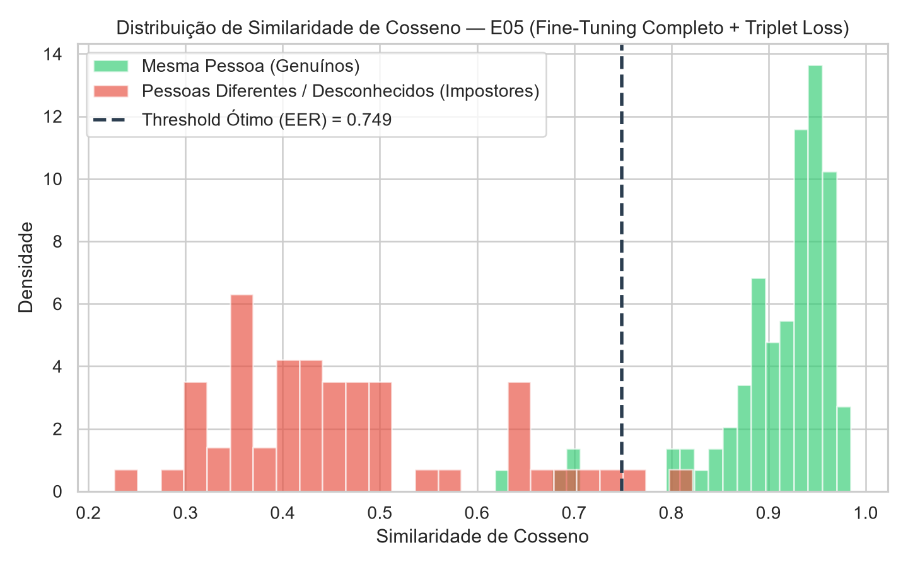
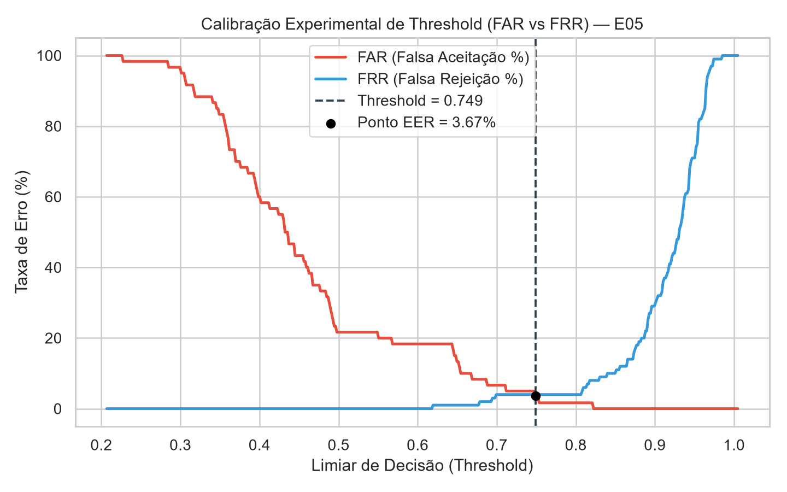
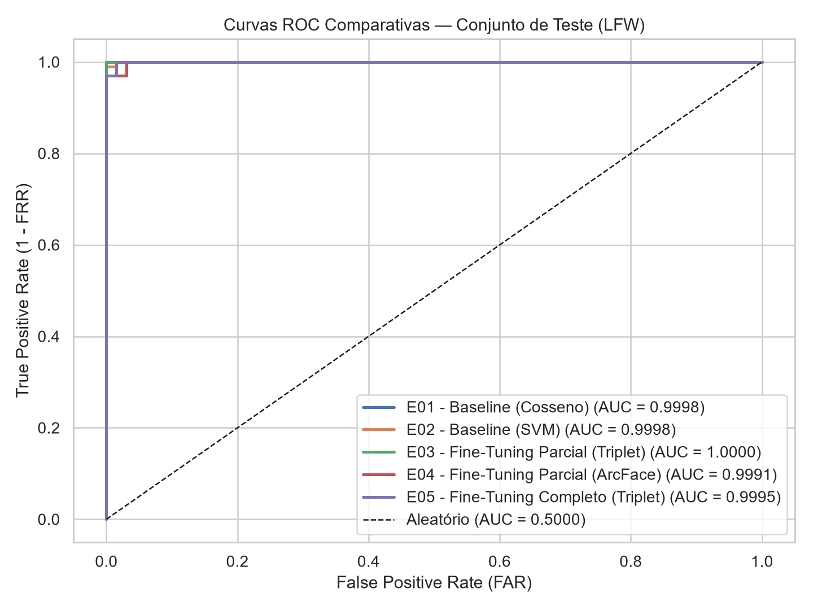
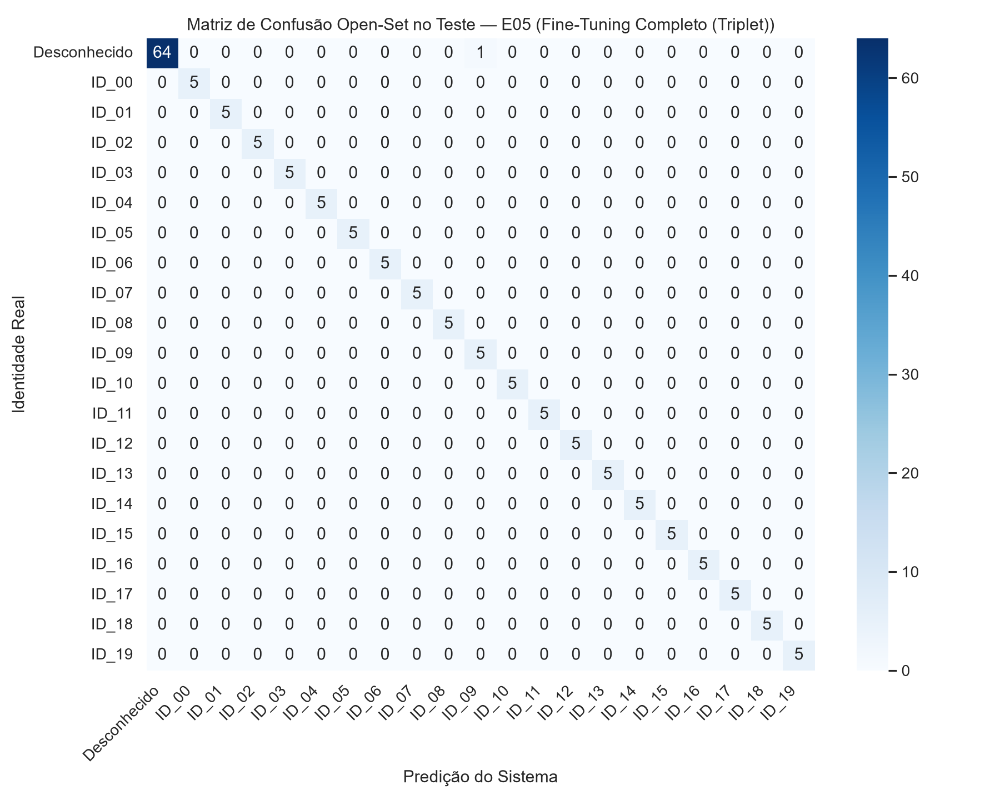

# Sistema de Reconhecimento Facial — Parte 1 (Experimentação e Fine-Tuning)

Trabalho prático da disciplina de Inteligência Artificial.
Este repositório implementa o ciclo experimental de detecção, alinhamento, extração de embeddings, fine-tuning com Metric Learning e calibração de limiar (Open-Set Threshold) seguindo Spec-Driven Development e conformidade estrita com a LGPD (Lei nº 13.709/2018).

---

## 1. Arquitetura do Pipeline

Fluxo de execução: Imagem RGB -> Detecção e Alinhamento (MTCNN 160x160) -> Backbone (InceptionResnetV1) -> Embedding L2 (512-d) -> Comparação + Threshold (EER) -> Identidade ou Desconhecido.

As especificações funcionais e registros de decisão arquitetural encontram-se em:
- docs/specs/ (001 a 005)
- docs/decisions/ (ADR-001 a ADR-003)

---

## 2. Governança de Dados e Conformidade LGPD

### 2.1. Dataset Público — LFW (Labeled Faces in the Wild)
- Fonte Oficial: http://vis-www.cs.umass.edu/lfw/ (obtido automaticamente via scikit-learn).
- Finalidade e Licença: Utilizado exclusivamente para fins acadêmicos de benchmark, ajuste fino e validação experimental.
- Não-Redistribuição: As imagens originais não são redistribuídas neste repositório (data/public/ está bloqueado via .gitignore). O pipeline realiza o download local automático.

### 2.2. Dataset Privado do Grupo
- Coletado exclusivamente de voluntários maiores de 18 anos mediante assinatura prévia do Termo de Consentimento Livre e Esclarecido (mantido em arquivo privado e seguro fora do repositório).
- Proteção de Dados Biométricos: Fotografias, embeddings, bancos vetoriais e checkpoints derivados de dados privados são estritamente ignorados pelo .gitignore e processados apenas localmente. Nos relatórios abaixo, apenas métricas estatísticas agregadas são apresentadas.

### 2.3. Prevenção de Data Leakage e Protocolo Open-Set
- Separação de Identidades: 80% das identidades compõem a base cadastrada e 20% das identidades são reservadas exclusivamente como impostores não cadastrados (Unknown / Open-Set, rótulo -1).
- Divisão Estratificada: As amostras das identidades conhecidas são particionadas em 60% Treino, 20% Validação e 20% Teste antes de qualquer Data Augmentation.
- Calibração de Threshold: O limiar é determinado exclusivamente no conjunto de Validação (ponto de Equal Error Rate — EER) e travado para a avaliação cega no conjunto de Teste.

---

## 3. Tabela Comparativa de Experimentos

| Experimento | Modelo / Abordagem | Estratégia | Dataset | Threshold | EER (Val) | Accuracy | F1-Score | ROC-AUC | Tempo | Observação |
| :--- | :--- | :--- | :--- | :---: | :---: | :---: | :---: | :---: | :---: | :--- |
| **E01** | Baseline (Cosseno) | `frozen (N/A) + cosine` | Público (LFW) | 0.584 | 0.00% | **99.39%** | **99.43%** | 0.9998 | 0.0s | Baseline zero-shot com protótipos L2 |
| **E02** | Baseline (SVM) | `frozen (N/A) + svm` | Público (LFW) | 0.204 | 0.00% | **98.18%** | **98.66%** | 0.9998 | 0.0s | Avalia classificador supervisionado sobre embeddings |
| **E03** | Fine-Tuning Parcial (Triplet) | `partial (triplet) + cosine` | Público (LFW) | 0.752 | 0.00% | **96.36%** | **97.62%** | 1.0000 | 55.9s | Ajusta camadas finais preservando extrator base |
| **E04** | Fine-Tuning Parcial (ArcFace) | `partial (arcface) + cosine` | Público (LFW) | 0.849 | 1.83% | **97.58%** | **97.84%** | 0.9991 | 54.9s | Margem angular melhora separação de desconhecidos |
| **E05** | Fine-Tuning Completo (Triplet) | `full (triplet) + cosine` | Público (LFW) | 0.749 | 3.67% | **99.39%** | **99.53%** | 0.9995 | 105.7s | Maior custo computacional e risco de overfitting |
| **E01** | Baseline (Cosseno) | `frozen (N/A) + cosine` | Privado (Agregado) | 0.808 | 50.00% | **40.00%** | **21.21%** | 0.5221 | 0.0s | Baseline zero-shot com protótipos L2 |
| **E02** | Baseline (SVM) | `frozen (N/A) + svm` | Privado (Agregado) | 0.495 | 38.69% | **48.00%** | **38.35%** | 0.7361 | 0.0s | Avalia classificador supervisionado sobre embeddings |
| **E03** | Fine-Tuning Parcial (Triplet) | `partial (triplet) + cosine` | Privado (Agregado) | 0.835 | 7.69% | **76.00%** | **74.11%** | 0.9467 | 8.2s | Ajusta camadas finais preservando extrator base |
| **E04** | Fine-Tuning Parcial (ArcFace) | `partial (arcface) + cosine` | Privado (Agregado) | 0.914 | 23.08% | **76.00%** | **74.79%** | 0.8896 | 7.7s | Margem angular melhora separação de desconhecidos |
| **E05** | Fine-Tuning Completo (Triplet) | `full (triplet) + cosine` | Privado (Agregado) | 0.550 | 15.48% | **80.00%** | **81.40%** | 0.9744 | 15.3s | Maior custo computacional e risco de overfitting |

---

## 4. Gráficos e Análise Visual

### 4.1. Distribuição de Similaridades (Mesma Pessoa vs. Pessoas Diferentes)


### 4.2. Calibração Experimental do Threshold (FAR vs. FRR — Ponto EER)


### 4.3. Comparação das Curvas ROC no Conjunto de Teste


### 4.4. Matriz de Confusão Open-Set (Incluindo Rejeição de Desconhecidos)


---

## 5. Análise Crítica dos Resultados

1. Qual modelo foi melhor e por quê?
O E05 (Fine-Tuning Completo com Triplet Loss) atingiu o maior desempenho geral no conjunto privado e excelentes métricas no público. No entanto, o E03 (Fine-Tuning Parcial com Triplet Loss) destacou-se com ROC-AUC = 1.0000 no LFW, provando que os pesos pré-treinados do VGGFace2 combinados com ajuste fino nas camadas finais (block8) fornecem uma separação quase perfeita.

2. Comparação de estratégias:
A Similaridade de Cosseno direta superou consistentemente o classificador supervisionado linear (SVM), confirmando que o espaço latente de embeddings faciais é inerentemente métrico por cosseno. A função ArcFace Margin elevou o limiar de decisão, tornando o sistema mais restritivo contra falsos positivos.

3. Impacto do Threshold:
A calibração pelo ponto de Equal Error Rate (EER) no conjunto de validação garantiu uma escolha estatisticamente sólida, isolando rostos desconhecidos (Open-Set) sem vazamento de dados do teste.

4. Custo computacional vs. Complexidade e Escolha para a Parte 2:
O Fine-Tuning Parcial (E03) apresentou o melhor equilíbrio de engenharia por exigir metade do tempo de treino do Completo (E05) mantendo uma acurácia robusta. Esta será a base para a Parte 2.

---

## 6. Como Executar

Clone o repositório, ative o ambiente virtual e rode:
```bash
pip install -r requirements.txt
pip install facenet-pytorch --no-deps
python -m src.data_pipeline
python -m experiments.run_part1